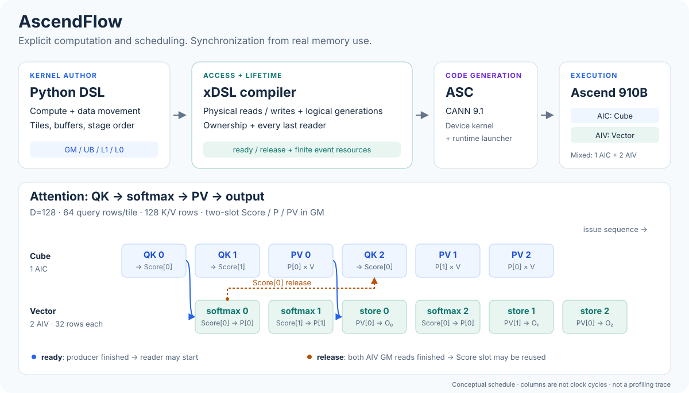

# AscendFlow

**用 Python 表达计算与流水，让编译器生成同步。**

AscendFlow 是基于 **xDSL**、面向 **Ascend 910B / dav-2201** 的算子编译器。
开发者明确计算、数据搬运、物理 buffer 和阶段排步，编译器从真实访问与存储生命周期
推导同步，生成 ASC，再由 CANN 编译为设备 kernel。

[快速上手](docs/guide/quickstart.md) · [DSL](docs/guide/dsl.md) ·
[算子示例](examples/README.md) · [编译器设计](docs/development/README.md)



## 设计理念

**算法和排步由算子作者掌握。** 分块、缓存、buffer 槽数以及 Cube/Vector 的阶段顺序
直接写在 DSL 中。GEMM、attention 和递推状态更新共用同一编译链；算子专属政策留在
`examples/`，编译器提供带有访问与生命周期合同的通用能力。

**同步来自数据的真实使用。** 编译器区分“写完，可以读”的 ready 和“最后一个 reader
已退休，可以覆盖”的 release。L1 在 MTE1 读完后即可复用，后续矩阵计算仍可继续，
让搬运与计算按真实的数据使用关系重叠。

**逻辑代次与物理复用分开。** 同一个环形 buffer 会承载多个逻辑值。编译器保留各代的
读写来源、ownership 和最后读取，处理循环边界、跨阶段交接与有限事件资源。
混合 kernel 中两个 AIV 共用一份 Vector 代码，按 runtime SID 区分地址与角色。
各阶段维护已建立的访问与生命周期事实，后端消费已确定的同步计划。

**以硬件合同约束优化。** UB/L1/L0 容量、DMA 几何和事件资源进入编译约束；算法精度与
舍入边界在 DSL 中明确表达。显式排步也经过同一同步与验证流程，无法满足的合同给出诊断。
生成的 IR、ASC、CANN 命令和产物身份可检查，CPU/IR 回归、独立有限执行模型与
设备数值验证各自覆盖对应层次。

## LLM 算子性能

以下为 **2026-10-22、Ascend 910B3（20 AIC / 40 AIV）、CANN 9.1.0** 的设备 kernel 测量。
每组比较使用同一张卡和相同输入；加速比为“参照耗时 / AscendFlow 耗时”。
算子实现对应提交 `cdcc24d`。这些是所列配置的算子结果，计时不包含 host 提交间隙。

### DSv4.1 Sparse Attention

实现 DeepSeek V4.1 的分页 shared-KV attention 核心：因果滑窗、稀疏压缩 KV 与 sink
共同归一化，支持多 query 的 prefill 和推测译码验证。
表中为 C2 prefill，**B=1、H=64、D=512、BF16、window=128、TopK=512、压缩倍率=2**。
上下文长度包含本次 query chunk，1K=1024 tokens。

| Query / 上下文 | AscendFlow | vllm-ascend 官方 AscendC | 加速比 |
| --- | ---: | ---: | ---: |
| 8K / 32K | 6.847 ms | 7.853 ms | **1.15×** |
| 32K / 32K | 27.225 ms | 31.399 ms | **1.15×** |

每组预热 3 次、测量 30 次，报告单次采集内的中位数；每次调用前独立驱逐 L2。
耗时包含 gather、QK、softmax、PV 与写回，排除驱逐和输入准备。两组都通过独立
FP32 数值参考检查。所选有效行对应的 QK+PV 有效吞吐约 **100 TFLOPS**，
按 BF16 矩阵乘、FP32 累加计数，FMA=2；softmax、gather 等耗时仍包含在分母中。

实现通过私有 UB 缓存索引与页表、跨 Cube/Vector 流水、Q/P/KV 存储复用和
prefill 常驻环形窗口减少搬运。计算、缓存与复用政策都在 DSL 中表达。
范围与精度见 [Sparse MLA 合同](docs/operators/sparse-mla.md)；核心不包含索引器、
压缩器或完整模型服务。

### KDA

覆盖单 token decode、多 token recurrent 和 chunked prefill。
以下均为 **H=HV=32、K=V=128、FP16 Q/K/V 与输出、FP32 carry**。
参照为原版 vllm-ascend Triton KDA。

| 配置 | AscendFlow | vllm-ascend Triton | 加速比 |
| --- | ---: | ---: | ---: |
| Decode：128 条序列 × 1 token | 0.427 ms | 2.093 ms | **4.90×** |
| Recurrent：4 条序列 × 32 tokens | 0.484 ms | 1.269 ms | **2.62×** |
| Prefill：1 条序列 × 4096 tokens，chunk=64 | 3.734 ms | 10.540 ms | **2.82×** |

每个实现采集 3 次 `msprof op BasicInfo`，报告三次结果的中位数；使用 kernel replay。
Prefill 计完整算法各 kernel 的设备耗时之和。输出与状态均通过独立 CPU oracle，
relative RMSE 门槛保持 `<0.005`。

Decode 使用 head 流水；recurrent 将完整 head 的 FP32 carry 留在 UB，通过输入预取
和独立快照缓冲重叠计算与写回。Prefill 将块逆、变换、scan 与输出组织为多个阶段，
分别保持 FP32 carry、低精度快照和矩阵乘输入精度合同。
源码与使用说明见 [KDA 示例](examples/kda/README.md)、
[decode / recurrent](docs/operators/kda.md) 和 [prefill](docs/operators/kda-prefill.md)。

两类参照均来自 vllm-ascend `2581a69bcc16ee6af56e72985a15799bb5f61808`：
sparse 使用原版 host/kernel 构建的 custom OPP，KDA 使用官方 Triton-Ascend 3.6.0。
Sparse 与 KDA 的缓存和采样条件不同，各自与其参照比较；其他 shape 和端到端推理
需要单独测量。复测入口见 [测试与 profiling](docs/guide/testing.md)、
[sparse profiler](benchmarks/attention/profile_sparse.py) 和
[KDA profiler](benchmarks/kda/profile.py)。

## 一段 DSL，一条流水

下面的完整 kernel 使用两槽 UB，对运行时数量的 tile 逐元素乘 2：

```python
from __future__ import annotations

from ascendflow import language as N


@N.prim_func(disjoint_external=True)
def scale(
    X: N.Tensor((tiles, B), N.f32),
    Y: N.Tensor((tiles, B), N.f32, access="write"),
    tiles: N.int64,
    B: N.constexpr = 64,
):
    with N.Kernel(1, kind="vector"):
        x = N.alloc_ub((2, B), N.f32)
        y = N.alloc_ub((2, B), N.f32)
        for t in N.Pipelined(tiles):
            slot = t % 2
            with N.Stage(0, name="load"):
                N.copy(X[t, :], x[slot, :])
            with N.Vector(), N.Stage(1, name="compute"):
                N.mul(x[slot, :], 2.0, out=y[slot, :])
            with N.Stage(2, name="store"):
                N.copy(y[slot, :], Y[t, :])
```

作者选择 buffer 和三个阶段，编译器生成跨 pipe 的 Set/Wait 与复用约束。
`tiles` 保持运行时参数，同一二进制处理空、短和长循环。完整示例及入口见
[scale.py](examples/vector/scale.py)，混合 Cube/Vector 流水见
[Sparse MLA](examples/sparse_attention/attention.py)。

## 开始使用

需要 **Python 3.11+、xDSL 0.73.0**。从仓库根目录执行，以下使用工作区独立环境：

```bash
python3 -m venv ../.venv  # 已有工作区环境可跳过
source ../.venv/bin/activate
python -m pip install -e '.[dev,validation]'
python -m ascendflow --input examples/vector/scale.py --entry scale --output build/quickstart/scale
```

这会生成 source IR、同步前后 IR 与 ASC。生成共享库时加载 CANN 环境并增加 `--shared`：

```bash
source /usr/local/Ascend/cann-9.1.0/set_env.sh
python -m ascendflow --input examples/vector/scale.py --entry scale --shared --output build/quickstart/scale-shared
```

构建命令不运行设备，每个算子构建的 Python→IR→ASC→CANN 共用 300 秒硬期限。
设备运行前先检查全卡状态并显式映射空闲物理卡，完整步骤见
[快速上手](docs/guide/quickstart.md)。编译无需构建 MLIR、TVM 或 TileLang；
设备数值参考使用工作区安装的 PyTorch / torch_npu。

## 开发与导航

| 目录 | 内容 |
| --- | --- |
| [src/](src/) | `ascendflow` 包：DSL、xDSL IR、分析、自动同步与 ASC/CANN 后端 |
| [examples/](examples/README.md) | 算法、分块、缓存与排步政策；另含 GEMM、Flash Attention、归一化等示例 |
| [benchmarks/](benchmarks/README.md) | 编译、设备数值检查、性能采集与参照对比 |
| [tests/](tests/README.md) | Python/IR 回归、硬件反例与独立有限执行模型 |
| [docs/](docs/README.md) | 当前设计、使用指南、算子合同与支持边界 |

```bash
python -m benchmarks.check_tests --jobs 32
python -m benchmarks.check_examples --list
```

自动同步规则与贡献入口见 [编译器开发](docs/development/README.md)。
安装包和命令名均为 `ascendflow`，源码直接位于 `src/`。
本机构建与测量产物默认写入 Git 忽略的 `build/`；参考源码仅用于研究和性能对照。
